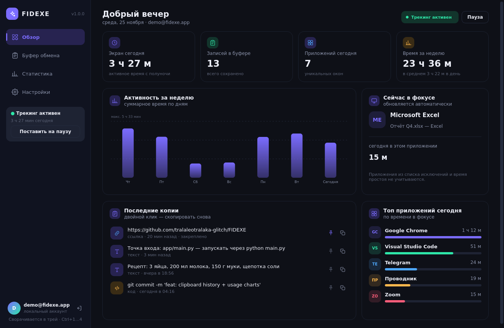
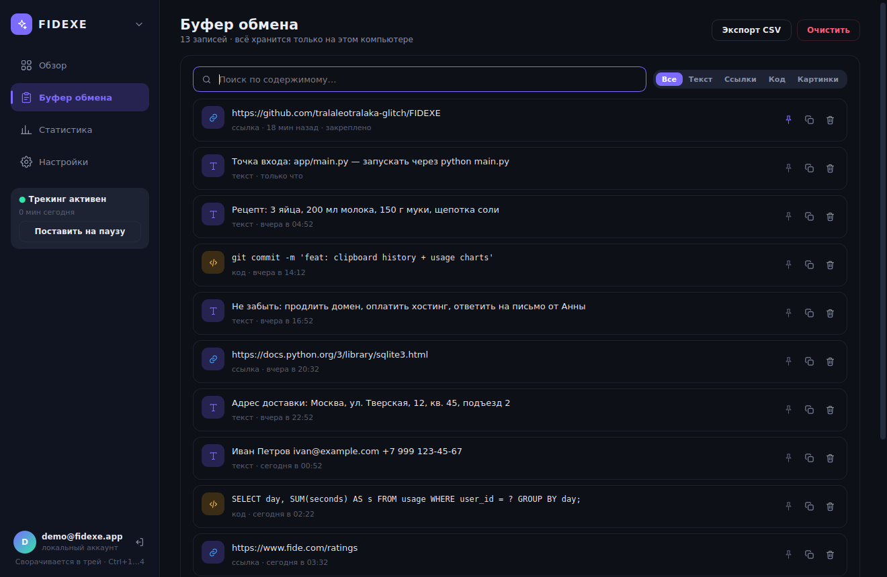
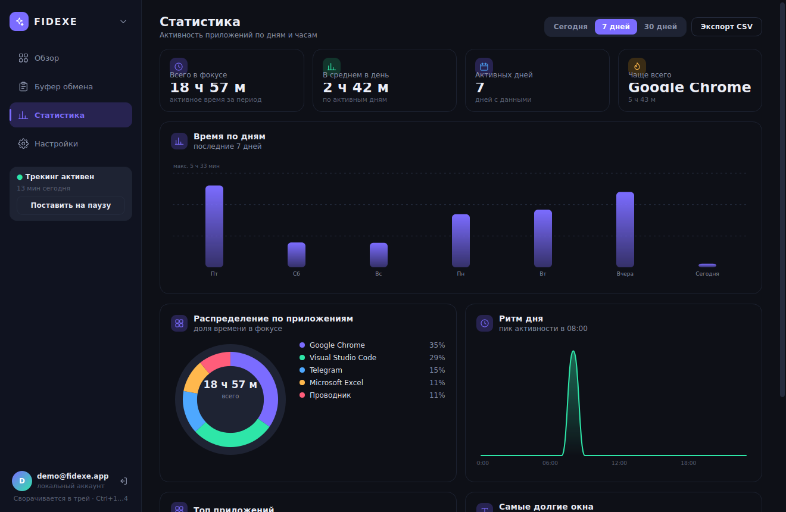
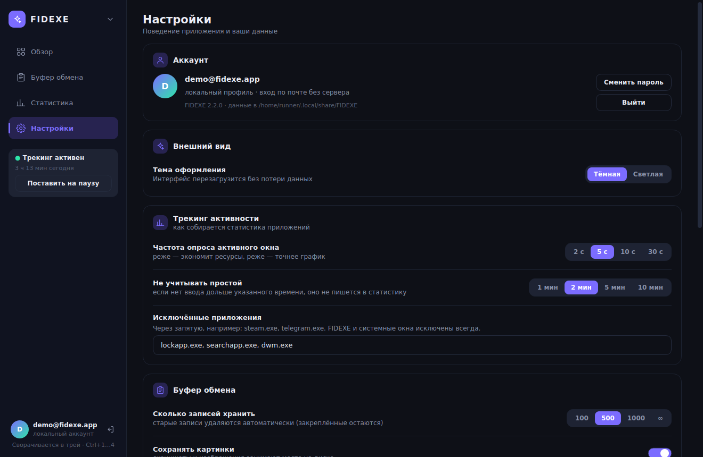
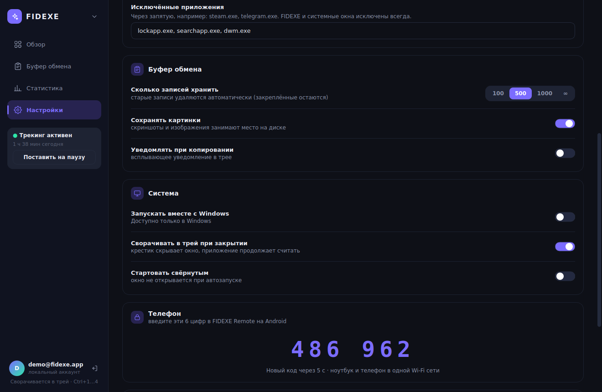
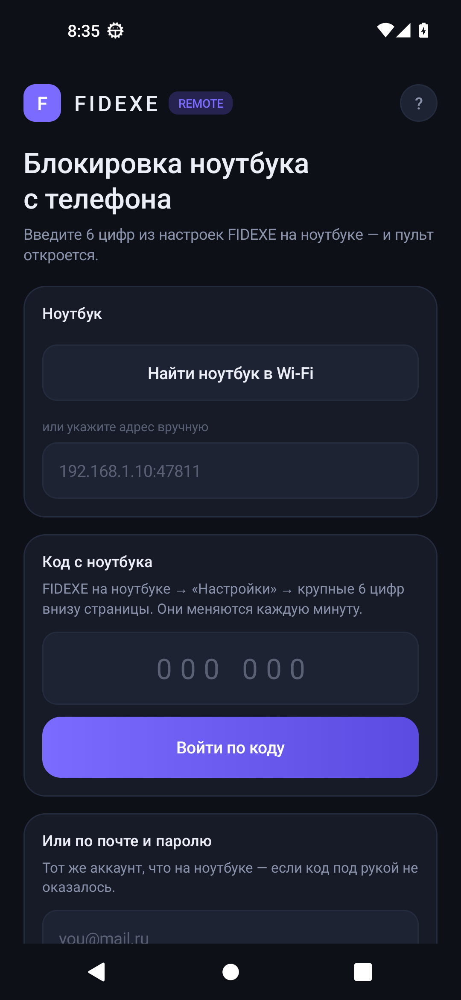
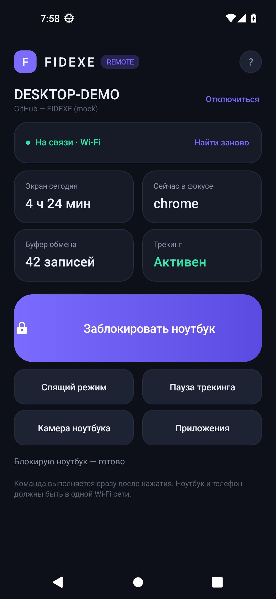
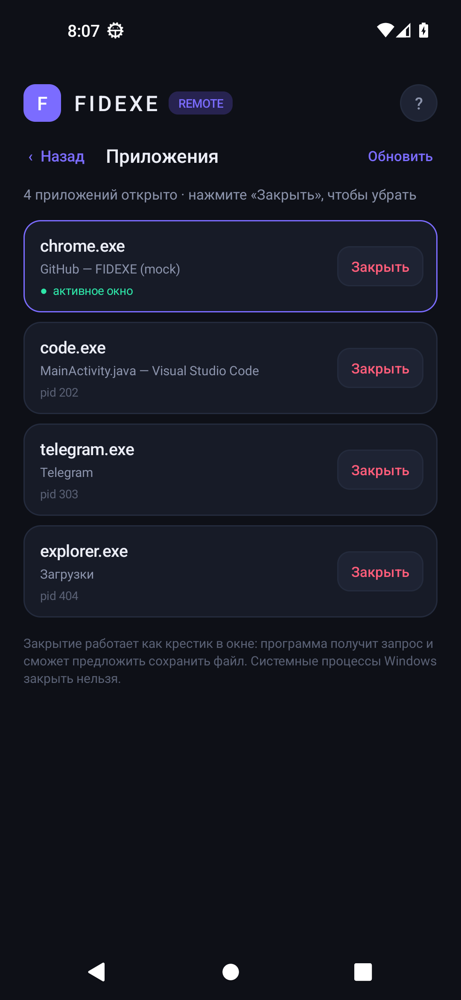
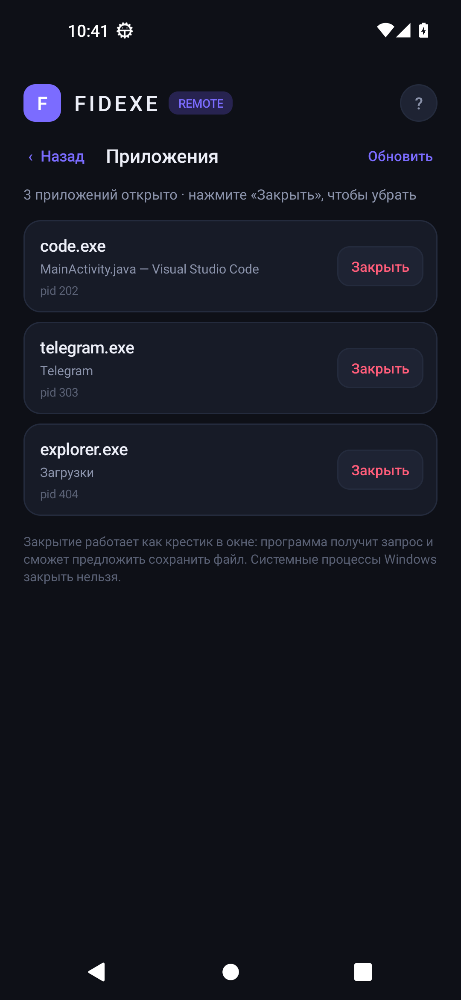
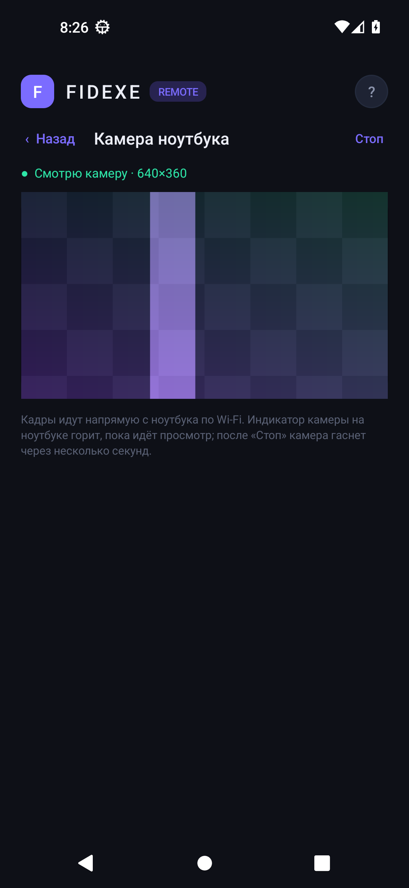

# FIDEXE

**FIDEXE** — небольшое приложение для Windows (один `.exe`, без установки), которое показывает
**историю буфера обмена** и **статистику использования приложений** в виде графиков.
Плюс **FIDEXE Remote** для Android: блокировка ноутбука с телефона по Wi-Fi.
Работает полностью офлайн: ни один байт не уходит в интернет.

## Скачать

| Что | Ссылка | Размер |
| --- | --- | --- |
| Windows 10/11 | **[FIDEXE.exe v2.0.0](https://github.com/tralaleotralaka-glitch/FIDEXE/releases/download/v2.0.0/FIDEXE.exe)** | ~86 МБ |
| Android 7.0+ | **[FIDEXE-Remote-2.0.0.apk](https://github.com/tralaleotralaka-glitch/FIDEXE/releases/download/android-v2.0.0/FIDEXE-Remote-2.0.0.apk)** | ~95 КБ |

1. Скачайте `FIDEXE.exe` и запустите — установка и права администратора не нужны.
2. SmartScreen может предупредить, потому что файл не подписан сертификатом:
   «Подробнее» → «Выполнить в любом случае». SHA256 указан в описании релиза.
3. APK ставится вручную (Android спросит разрешение на установку из неизвестного источника).



## Возможности

**Буфер обмена**
- автоматическая история текста, ссылок, кода и изображений;
- поиск по содержимому, фильтры по типу, закрепление важных записей;
- копирование записи обратно в буфер одним кликом;
- лимит истории (100 / 500 / 1000 / без ограничения) с автоочисткой;
- экспорт истории в CSV.

**Статистика приложений**
- какой процесс был в фокусе, как долго и с каким заголовком окна;
- график по дням (сегодня / 7 / 30 дней), донат-диаграмма по приложениям, «ритм дня» по часам;
- топ приложений и самые долгие окна;
- экспорт статистики в CSV для Excel (разделитель `;`, UTF-8 BOM).

**Аккаунты и настройки**
- вход по почте и паролю: несколько локальных профилей на одном ПК;
- пароль хранится как хеш **PBKDF2-SHA256** (240 000 итераций, соль на пользователя);
- поддержка гостевого режима без регистрации;
- тёмная и светлая темы, интервал опроса, порог простоя, чёрный список приложений;
- автозапуск с Windows, сворачивание в трей, уведомления о копировании.

**Управление с телефона (Android)**
- блокировка ноутбука одной кнопкой из Wi-Fi сети;
- **вход по коду из 6 цифр** — код показан в настройках и меняется каждую минуту;
- **камера ноутбука на телефоне**: ~8 кадров в секунду, включается отдельным переключателем;
- **список открытых программ** и кнопка «Закрыть» (как крестик в окне, без потери данных);
- спящий режим, пауза трекинга и живая статистика на телефоне;
- запасной вход по почте и паролю того же аккаунта.

**Мелочи, которые реально помогают**
- «Сейчас в фокусе» — активное окно и время в нём за сегодня;
- пауза трекинга (кнопка, трей, `Ctrl+Shift+P`);
- время простоя не учитывается, поэтому графики не «раздуваются» ночью;
- собственные окна и системные процессы исключены из статистики автоматически;
- одиночный экземпляр: повторный запуск просто разворачивает уже открытое окно;
- все ошибки пишутся в `fidexe.log` рядом с базой, приложение не «падает молча».

| Буфер обмена | Статистика |
| --- | --- |
|  |  |

| Настройки | Вход |
| --- | --- |
|  |  |

Светлая тема:


## Блокировка ноутбука с телефона (Android)

Кнопка блокировки работает **по локальной сети**: телефон обращается напрямую к ноутбуку,
без сервера и без интернета.

1. На ноутбуке: **Настройки → Телефон и блокировка → «Разрешить управление с телефона»**.
   Появится адрес вида `192.168.1.10:47811` и **код из 6 цифр**, который меняется каждую минуту,
   — рядом тикает таймер до следующего кода.
2. Установите APK и откройте приложение — оно найдёт ноутбук в Wi-Fi автоматически (mDNS)
   или примет адрес вручную.
3. Впишите эти **шесть цифр** и нажмите «Войти по коду» — сразу откроется пульт этого ноутбука.
   Запасной путь: вход **той же почтой и паролем**, что и в FIDEXE на ноутбуке.
4. Большая кнопка «Заблокировать ноутбук» сразу гасит экран ПК. Рядом: «Спящий режим»,
   пауза/включение трекинга и живые цифры — сколько сегодня работал ноутбук, что в фокусе,
   сколько записей в буфере.

Кроме блокировки на пульте есть две вкладки:

- **«Камера ноутбука»** — картинка с веб-камеры ПК. Камера выключена, пока на ноутбуке не включён
  переключатель «Камера с телефона»; включается только по запросу с телефона и гаснет через 25 секунд
  после «Стоп» (индикатор камеры на ноутбуке при этом честно горит).
- **«Приложения»** — что сейчас открыто на ноутбуке: процесс, заголовок окна, отметка «активное окно».
  Кнопка «Закрыть» отправляет окну `WM_CLOSE` — то же, что нажать крестик: программа успевает
  предложить сохранить файл. Системные процессы Windows в список не попадают.

Код живёт в настройках ноутбука и меняется каждую минуту:



| Подключение | Пульт | Готово |
| --- | --- | --- |
|  |  |  |

| Приложения на ноутбуке | После «Закрыть» | Камера ноутбука |
| --- | --- | --- |
|  |  |  |

Скриншоты сняты на эмуляторе в CI против мок-ноутбука, поэтому вместо вашей веб-камеры на кадре
тестовая картинка — на реальном ПК там будет изображение с камеры.

**Как устроено и почему это безопасно**

- Код — это `HMAC-SHA256(секрет установки, номер минуты)`, усечённый до 6 цифр. Секрет
  создаётся на ноутбуке один раз (`pair_secret` в папке данных) и никуда не уходит.
  Сервер принимает код текущей и предыдущей минуты, поэтому опоздание на пару секунд не мешает.
- Пароль **не передаётся**: ноутбук отдаёт соль и случайный запрос, телефон считает
  PBKDF2-SHA256 (как в базе ноутбука) и подписывает запрос HMAC-подписью.
- Дальше телефон работает по короткоживущему токену (2 часа). Сервер умеет ровно следующее:
  `lock`, `sleep`, `pause`, `resume`, «закрыть окно программы» и кадр камеры — ничего, что удаляет
  данные, меняет пароль или запускает новые программы.
- Камера и закрытие программ выключены по умолчанию для камеры и недоступны без входа по коду.
- Сервер включается вручную, слушает только локальную сеть, ограничивает число попыток входа
  (8 за 5 минут — в том числе для кода) и пишет всё в `fidexe.log`.
- Разблокировать компьютер удалённо нельзя — Windows этого не позволяет, только с клавиатуры.

**Честное ограничение:** из другой сети (мобильный интернет, кафе, другой город) кнопка не сработает —
для этого нужен собственный сервер-ретранслятор с шифрованием, это отдельная история.
Если нужно «блокировать откуда угодно» — скажите, добавим вариант через релей.

## Горячие клавиши

| Комбинация | Действие |
| --- | --- |
| `Ctrl+1 … Ctrl+4` | Обзор / Буфер / Статистика / Настройки |
| `Ctrl+F` | Поиск по истории буфера |
| `Ctrl+Shift+P` | Пауза трекинга |
| `Esc` | Свернуть окно в трей |
| двойной клик по записи | скопировать её снова |

## Где хранятся данные

`%APPDATA%\FIDEXE` — база `fidexe.db` (SQLite), картинки в `images/`, настройки в `settings.json`,
лог `fidexe.log`. Папку можно открыть из «Настройки → Данные».

Удалить всё можно там же: «Удалить все данные». Приложение не отправляет данные в сеть и не
требует интернет-соединения.

## Сборка `.exe`

Готовый файл собирается в GitHub Actions на `windows-latest` (workflow
[`.github/workflows/build-exe.yml`](.github/workflows/build-exe.yml)):

1. `pip install -r requirements.txt pyinstaller`
2. `pyinstaller --noconfirm --clean build.spec`
3. результат — `dist/FIDEXE.exe` (один файл, без консольного окна, со своей иконкой и версией).

Сборка проверяется автоматически: запускается `FIDEXE.exe --selftest`, который поднимает Qt,
создаёт окно, обходит все разделы и выходит с кодом 0.

Локально из исходников:

```powershell
python -m venv .venv
.venv\Scripts\pip install -r requirements.txt
.venv\Scripts\python main.py
```

## Структура проекта

```
app/
  core/            # sqlite-хранилище, авторизация, трекер активного окна, экспорт,
                   # LAN-сервер для телефона (remote.py), блокировка Windows (power.py)
  ui/              # тема, виджеты, графики на QPainter, страницы, окно входа
  main.py          # точка входа, single-instance, tray, обработка ошибок
android/           # FIDEXE Remote: Java + Gradle, без сторонних зависимостей
main.py            # обёртка для PyInstaller
build.spec         # one-file сборка
tools/             # иконка, smoke-тесты, mock-сервер и adb-помощник для UI-тестов
```

## Проверки

```bash
python tools/smoke_test.py      # 36 проверок: авторизация, буфер, статистика, темы, экспорт
python tools/remote_test.py     # 64 проверки LAN-API: код подключения, камера, список программ
python tools/screenshots.py out # рендер всех экранов в PNG (headless)
python tools/mock_remote.py     # мок ноутбука для ручной проверки Android-приложения
```

Android-приложение проверяется в CI на эмуляторе: сборка APK → установка → подключение
к мок-серверу **шестизначным кодом** → вкладки камеры и приложений → закрытие программы →
блокировка → скриншоты в `docs/android/`.

## Ограничения

- трекинг активных окон использует Win32 API и работает только в Windows; на других ОС
  история буфера и интерфейс работают, статистика — нет;
- аккаунты локальные: почта служит логином, письма не отправляются (это честно указано в окне входа);
- данные не шифруются на диске — для защиты используйте шифрование диска Windows (BitLocker);
- блокировка с телефона работает только в одной Wi-Fi сети (без интернет-релея);
- камера с телефона требует веб-камеру на ПК и собранный exe (в нём есть opencv — из-за этого
  exe вырос примерно со 42 до 110 МБ); список и закрытие программ — только Windows;
- кадры камеры идут по локальной сети без шифрования внутри Wi-Fi (как и весь остальной трафик
  пульта), поэтому не пользуйтесь чужими и гостевыми сетями;
- APK и exe подписаны самодельными ключами: это sideload-сборки, а не магазины приложений.

Лицензия: свободное использование для личных целей.
