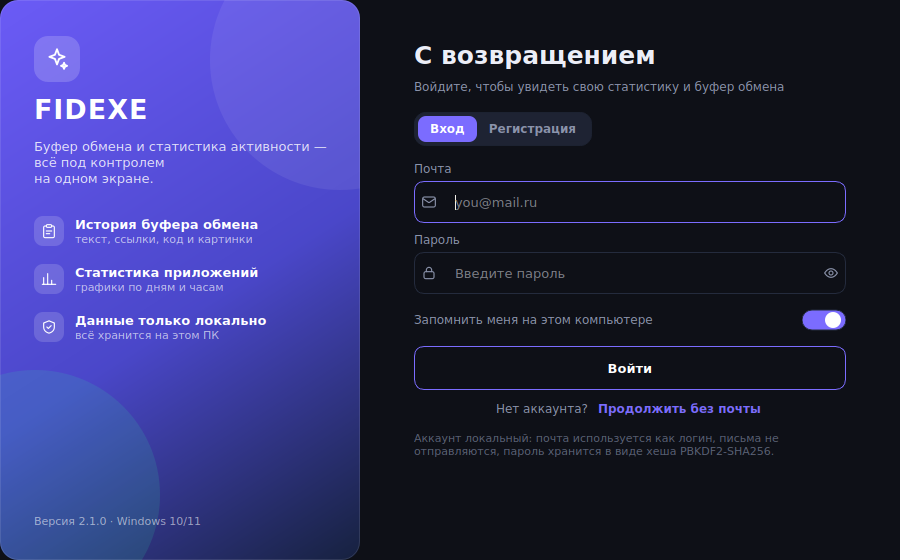
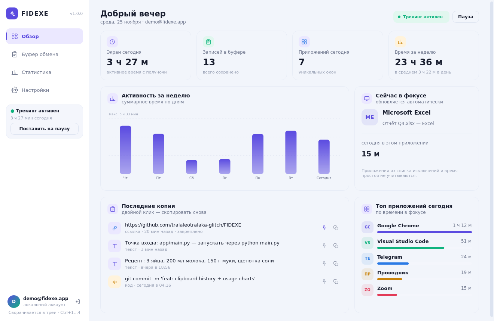
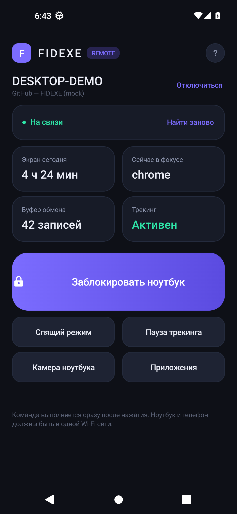

# FIDEXE

**FIDEXE** — небольшое приложение для Windows (один `.exe`, без установки), которое показывает
**историю буфера обмена** и **статистику использования приложений** в виде графиков.
Плюс **FIDEXE Remote** для Android: блокировка ноутбука с телефона по Wi-Fi.
Работает полностью офлайн: ни один байт не уходит в интернет.

## Скачать

| Что | Ссылка | Размер |
| --- | --- | --- |
| Windows 10/11 | **[FIDEXE.exe v2.3.0](https://github.com/tralaleotralaka-glitch/FIDEXE/releases/download/v2.3.0/FIDEXE.exe)** | ~86 МБ |
| Android 7.0+ | **[FIDEXE-Remote-2.3.0.apk](https://github.com/tralaleotralaka-glitch/FIDEXE/releases/download/android-v2.3.0/FIDEXE-Remote-2.3.0.apk)** | ~90 КБ |

1. Скачайте `FIDEXE.exe` и запустите — установка и права администратора не нужны.
2. SmartScreen может предупредить, потому что файл не подписан сертификатом:
   «Подробнее» → «Выполнить в любом случае». SHA256 указан в описании релиза.
3. APK ставится вручную (Android спросит разрешение на установку из неизвестного источника).


## Возможности

**Буфер обмена**
- автоматическая история текста, ссылок, кода и изображений;
- поиск по содержимому, фильтры по типу, закрепление важных записей;
- копирование записи обратно в буфер одним кликом;
- лимит истории (100 / 500 / 1000 / без ограничения) с автоочисткой;
- экспорт истории в CSV.

**Статистика приложений**
- какой процесс был в фокусе, как долго и с каким заголовком окна;
- график по дням (сегодня / 7 / 30 дней), донат-диаграмма по приложениям, «ритм дня» по часам;
- топ приложений и самые долгие окна;
- экспорт статистики в CSV для Excel (разделитель `;`, UTF-8 BOM).

**Аккаунты и настройки**
- вход по почте и паролю: несколько локальных профилей на одном ПК;
- пароль хранится как хеш **PBKDF2-SHA256** (240 000 итераций, соль на пользователя);
- поддержка гостевого режима без регистрации;
- тёмная и светлая темы, интервал опроса, порог простоя, чёрный список приложений;
- автозапуск с Windows, сворачивание в трей, уведомления о копировании.

**Управление с телефона (Android)**
- блокировка ноутбука одной кнопкой из Wi-Fi сети;
- **вход по коду из 6 цифр** — только он и остался в настройках ноутбука: код меняется
  каждую минуту, ничего включать не нужно;
- **работает из любой сети**: дома — напрямую по Wi-Fi, на улице и в другом городе — через
  зашифрованный интернет-канал (порт-форвардинг и настройка роутера не нужны);
- **камера ноутбука на телефоне**: ~8 кадров в секунду, открывается по запросу с телефона;
- **список открытых программ** и кнопка «Закрыть» (как крестик в окне, без потери данных);
- спящий режим, пауза трекинга и живая статистика на телефоне;
- запасной вход по почте и паролю того же аккаунта.

**Мелочи, которые реально помогают**
- «Сейчас в фокусе» — активное окно и время в нём за сегодня;
- пауза трекинга (кнопка, трей, `Ctrl+Shift+P`);
- время простоя не учитывается, поэтому графики не «раздуваются» ночью;
- собственные окна и системные процессы исключены из статистики автоматически;
- одиночный экземпляр: повторный запуск просто разворачивает уже открытое окно;
- все ошибки пишутся в `fidexe.log` рядом с базой, приложение не «падает молча».

| Буфер обмена | Статистика |
| --- | --- |
|  |  |

| Настройки | Вход |
| --- | --- |
|  |  |

Светлая тема:



## Блокировка ноутбука с телефона (Android)

Кнопка блокировки работает **по локальной сети**: телефон обращается напрямую к ноутбуку,
без сервера и без интернета.

1. На ноутбуке просто войдите в аккаунт по почте и откройте «Настройки». Внизу страницы —
   **только шесть цифр**, больше там нет ничего: ни тумблеров, ни адреса, ни кнопок.
   Сервер для телефона запускается сам.
2. Установите APK и откройте приложение — оно найдёт ноутбук само: одновременно по mDNS и
   UDP-широковещательным запросом на `255.255.255.255:47812`, при этом держит multicast-лок.
   Если сеть мешает поиску, адрес можно вписать руками.
3. Впишите эти **шесть цифр** и нажмите «Войти по коду» — сразу откроется пульт этого ноутбука.
   Запасной путь: вход **той же почтой и паролем**, что и в FIDEXE на ноутбуке.
4. Большая кнопка «Заблокировать ноутбук» сразу гасит экран ПК. Рядом: «Спящий режим»,
   пауза/включение трекинга, «Камера ноутбука» и «Приложения» — плюс живые цифры: сколько сегодня
   работал ноутбук, что в фокусе, сколько записей в буфере.

Телефон запоминает ноутбук: вход по коду живёт 30 дней и переживает перезапуск FIDEXE и
перезагрузку ПК. Если роутер выдал ноутбуку новый адрес (это бывает после перезагрузки),
на пульте есть «Найти заново» — приложение переищет ноутбук и продолжит с того же места,
цифры вводить не нужно.

### Из любой точки: хоть километр, хоть сто

Дома телефон идёт к ноутбуку напрямую по Wi-Fi — это самый быстрый путь. Если ноутбука в
этой сети нет (вы на улице, в метро, в другом городе), приложение само переключается на
**зашифрованный интернет-канал**: телефон и ноутбук оба выходят наружу на публичный
MQTT-брокер (`broker.hivemq.com`, запасные `broker.emqx.io` и `test.mosquitto.org`), и дальше
всё общение идёт через него.

- **Ничего настраивать не нужно**: ни портов на роутере, ни статического IP, ни аккаунтов.
  Оба конца сами устанавливают исходящее TLS-соединение, поэтому это работает и за NAT,
  и в мобильном интернете.
- **Сквозное шифрование.** Ключ AES-256-GCM создаётся на ноутбуке при подключении телефона по
  коду и передаётся телефону по локальной сети. Через брокер идут только случайное имя топика
  и шифротекст: ни брокер, ни провайдер не видят ни команд, ни статистики, ни кадров камеры.
- **Задержка** — доли секунды на команду (блокировка приходит за 1–2 секунды), камера через
  интернет идёт заметно медленнее, чем по Wi-Fi.
- Пульт показывает, каким путём он сейчас связан: «На связи · Wi-Fi» или «На связи · через интернет».
- Если брокер недоступен (редко, но публичные сервисы иногда лежат), приложение честно скажет
  «ноутбук не ответил через интернет», а дома всё продолжит работать по Wi-Fi.

Проверяется это в CI по-настоящему: прогон поднимает «ноутбук» отдельно от телефона, соединяет
обоих через публичный брокер, отключает локальную сеть и нажимает «Заблокировать ноутбук» —
команда должна дойти через интернет. Результат последнего прогона: `docs/android/CI-STATUS.md`.

Кроме блокировки на пульте есть две вкладки:

- **«Камера ноутбука»** — картинка с веб-камеры ПК. Камера открывается только по запросу с телефона
  и гаснет через 25 секунд после «Стоп» (индикатор камеры на ноутбуке при этом честно горит).
- **«Приложения»** — что сейчас открыто на ноутбуке: процесс, заголовок окна, отметка «активное окно».
  Кнопка «Закрыть» отправляет окну `WM_CLOSE` — то же, что нажать крестик: программа успевает
  предложить сохранить файл. Системные процессы Windows в список не попадают.

Код живёт в настройках ноутбука и меняется каждую минуту:


| Подключение | Пульт | Готово |
| --- | --- | --- |
|  |  |  |

| Приложения на ноутбуке | После «Закрыть» | Камера ноутбука |
| --- | --- | --- |
|  |  |  |

Скриншоты сняты на эмуляторе в CI против мок-ноутбука, поэтому вместо вашей веб-камеры на кадре
тестовая картинка — на реальном ПК там будет изображение с камеры.

Каждый коммит CI ставит настоящий APK на эмулятор и проходит путь пользователя: адрес → 6 цифр →
пульт → перезапуск приложения (телефон должен остаться подключённым) → «Найти заново» →
приложения → камера → блокировка. Отчёт последнего прогона лежит в
[`docs/android/CI-STATUS.md`](docs/android/CI-STATUS.md).

**Как устроено и почему это безопасно**

- Код — единственный ключ к ноутбуку: `HMAC-SHA256(секрет установки, номер минуты)`, усечённый
  до 6 цифр. Секрет создаётся на ноутбуке один раз (`pair_secret` в папке данных) и никуда не уходит;
  код виден только на экране самого ноутбука.
  Сервер принимает код текущей и предыдущей минуты, поэтому опоздание на пару секунд не мешает.
- Пароль **не передаётся**: ноутбук отдаёт соль и случайный запрос, телефон считает
  PBKDF2-SHA256 (как в базе ноутбука) и подписывает запрос HMAC-подписью.
- Интернет-канал использует ключ, созданный при подключении по коду: `relay_link.json` в папке
  данных (только на вашем ноутбуке) и копия на телефоне. Без этого ключа сообщения в брокере
  просто отбрасываются — можно проверить в тестах: чужой ключ не получает ничего.
- Дальше телефон работает по токену: 30 дней после входа по коду (вход по паролю — 2 часа).
  В папке данных хранится только SHA256 токена, сам токен остаётся на телефоне. Сервер умеет ровно следующее:
  `lock`, `sleep`, `pause`, `resume`, «закрыть окно программы» и кадр камеры — ничего, что удаляет
  данные, меняет пароль или запускает новые программы.
- Камера и закрытие программ работают только после успешного входа по коду (или по паролю).
- Сервер поднимается автоматически после входа в аккаунт, слушает только локальную сеть,
  ограничивает число попыток входа (8 за 5 минут — в том числе для кода) и пишет всё в `fidexe.log`.
  Если порт 47811 занят, берётся следующий свободный — телефон узнаёт номер порта из ответа
  на UDP-запрос, так что вводить его вручную не нужно.
- Windows Firewall: при старте FIDEXE сам пытается добавить правило для своей программы
  (профили «частная сеть» и «домен»). Если Windows не даёт это сделать без прав администратора,
  приложение один раз спрашивает «Разрешить доступ с телефона?» — ответ «Да» открывает запрос UAC
  и добавляет правило. Позже то же самое доступно в меню: «Разрешить доступ с телефона
  (брандмауэр)…». Без этого правила телефон упирается в «ноутбук не отвечает» — это самая частая
  причина, почему «не работает».
- Разблокировать компьютер удалённо нельзя — Windows этого не позволяет, только с клавиатуры.

**Честное ограничение:** интернет-канал работает через публичный брокер сообщений. Это бесплатно и
не требует аккаунтов, но зависит от чужого сервиса: если он недоступен, снаружи команды не пройдут
(дома по Wi-Fi всё работает). Хотите полностью независимый вариант — можно поднять свой брокер
и указать его адрес: `FIDEXE_RELAY_BROKERS=my.broker:8883`.

## Горячие клавиши

| Комбинация | Действие |
| --- | --- |
| `Ctrl+1 … Ctrl+4` | Обзор / Буфер / Статистика / Настройки |
| `Ctrl+F` | Поиск по истории буфера |
| `Ctrl+Shift+P` | Пауза трекинга |
| `Esc` | Свернуть окно в трей |
| двойной клик по записи | скопировать её снова |

## Где хранятся данные

`%APPDATA%\FIDEXE` — база `fidexe.db` (SQLite), картинки в `images/`, настройки в `settings.json`,
лог `fidexe.log`. Папку можно открыть из «Настройки → Данные».

Удалить всё можно там же: «Удалить все данные». Приложение не отправляет данные в сеть и не
требует интернет-соединения.

## Сборка `.exe`

Готовый файл собирается в GitHub Actions на `windows-latest` (workflow
[`.github/workflows/build-exe.yml`](.github/workflows/build-exe.yml)):

1. `pip install -r requirements.txt pyinstaller`
2. `pyinstaller --noconfirm --clean build.spec`
3. результат — `dist/FIDEXE.exe` (один файл, без консольного окна, со своей иконкой и версией).

Сборка проверяется автоматически: запускается `FIDEXE.exe --selftest`, который поднимает Qt,
создаёт окно, обходит все разделы и выходит с кодом 0.

Локально из исходников:

```powershell
python -m venv .venv
.venv\Scripts\pip install -r requirements.txt
.venv\Scripts\python main.py
```

## Структура проекта

```
app/
  core/            # sqlite-хранилище, авторизация, трекер активного окна, экспорт,
                   # LAN-сервер для телефона (remote.py), блокировка Windows (power.py)
  ui/              # тема, виджеты, графики на QPainter, страницы, окно входа
  main.py          # точка входа, single-instance, tray, обработка ошибок
android/           # FIDEXE Remote: Java + Gradle, без сторонних зависимостей
main.py            # обёртка для PyInstaller
build.spec         # one-file сборка
tools/             # иконка, smoke-тесты, mock-сервер и adb-помощник для UI-тестов
```

## Проверки

```bash
python tools/smoke_test.py      # 36 проверок: авторизация, буфер, статистика, темы, экспорт
python tools/remote_test.py     # 64 проверки LAN-API: код подключения, камера, список программ
python tools/screenshots.py out # рендер всех экранов в PNG (headless)
python tools/mock_remote.py     # мок ноутбука для ручной проверки Android-приложения
```

Android-приложение проверяется в CI на эмуляторе: сборка APK → установка → подключение
к мок-серверу **шестизначным кодом** → вкладки камеры и приложений → закрытие программы →
блокировка → скриншоты в `docs/android/`.

## Ограничения

- трекинг активных окон использует Win32 API и работает только в Windows; на других ОС
  история буфера и интерфейс работают, статистика — нет;
- аккаунты локальные: почта служит логином, письма не отправляются (это честно указано в окне входа);
- данные не шифруются на диске — для защиты используйте шифрование диска Windows (BitLocker);
- блокировка с телефона работает только в одной Wi-Fi сети (без интернет-релея);
- камера с телефона требует веб-камеру на ПК и собранный exe (в нём есть opencv — из-за этого
  exe вырос примерно с 42 до 86 МБ); список и закрытие программ — только Windows;
- камера доступна любому, кто вошёл по коду, — то есть тому, кто видит экран вашего ноутбука;
- кадры камеры идут по локальной сети без шифрования внутри Wi-Fi (как и весь остальной трафик
  пульта), поэтому не пользуйтесь чужими и гостевыми сетями;
- APK и exe подписаны самодельными ключами: это sideload-сборки, а не магазины приложений.

Лицензия: свободное использование для личных целей.
